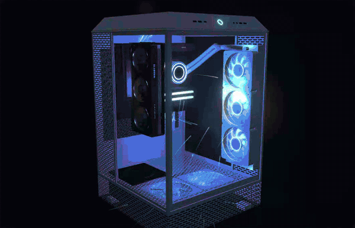
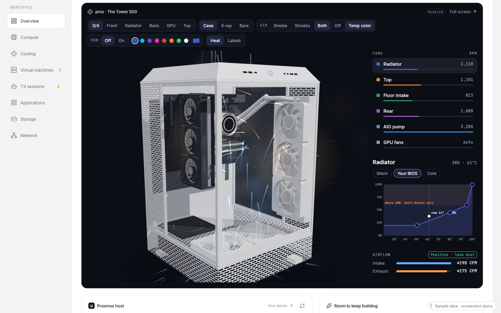
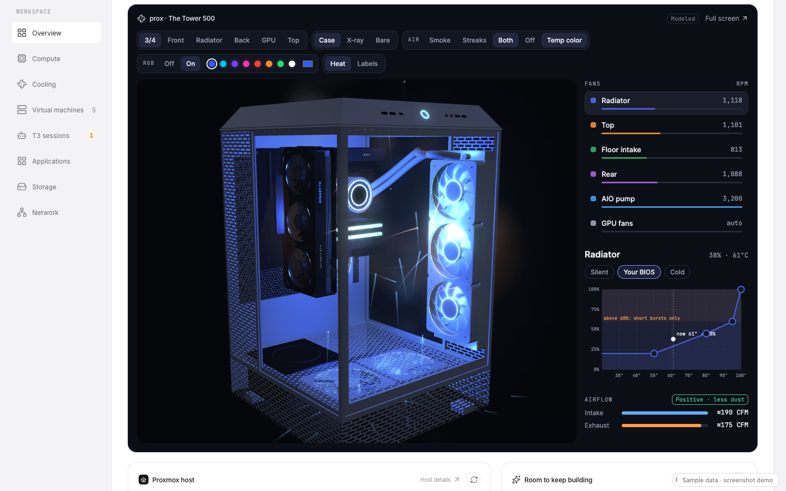
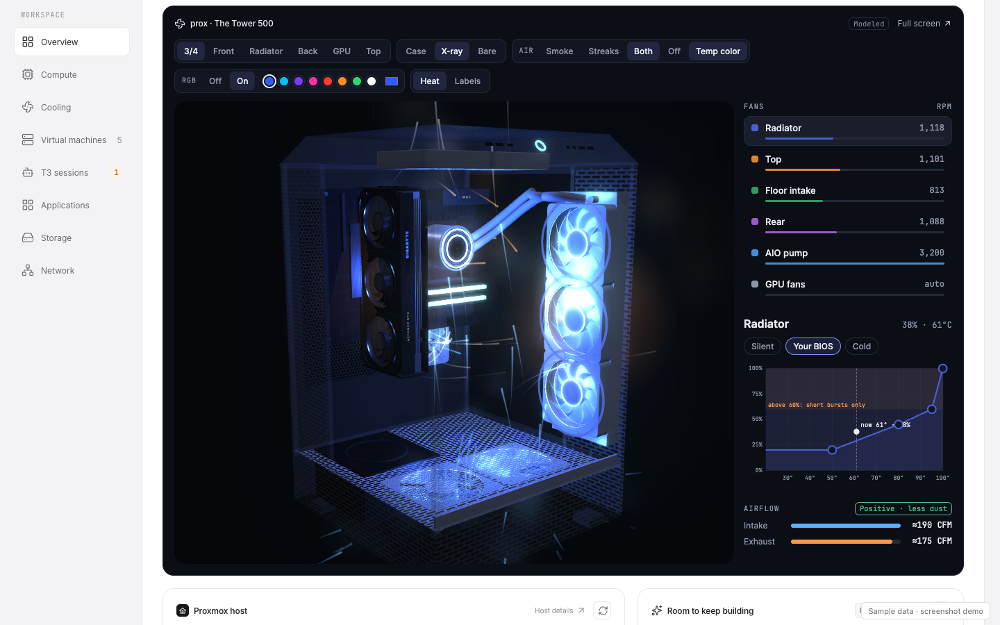
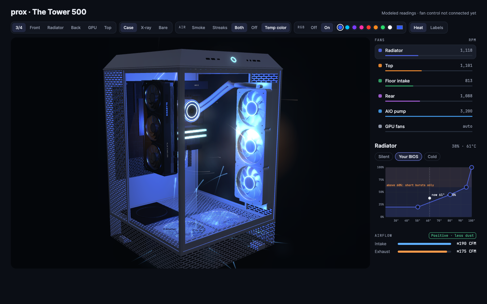
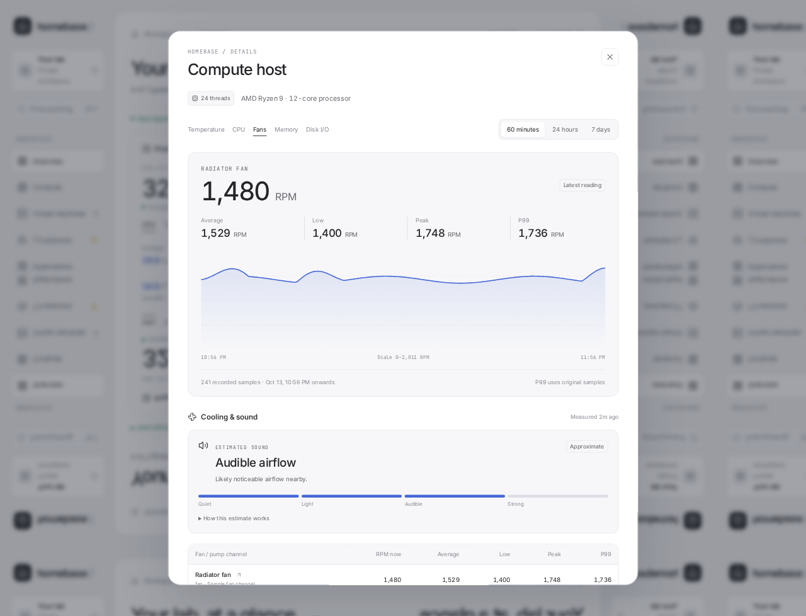
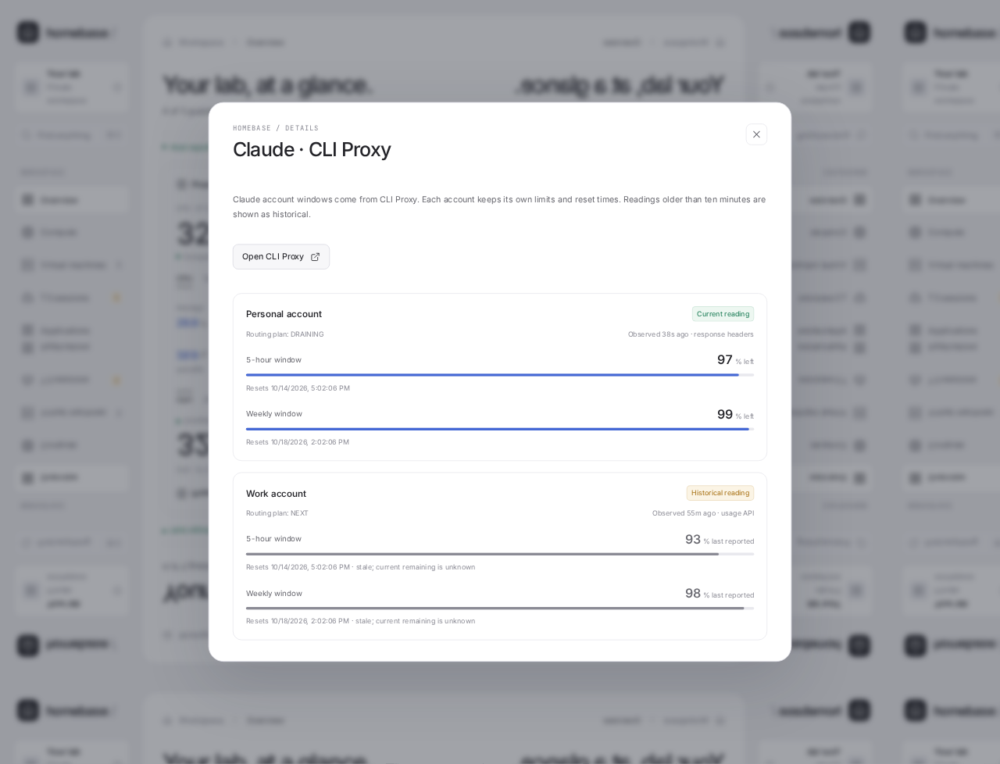
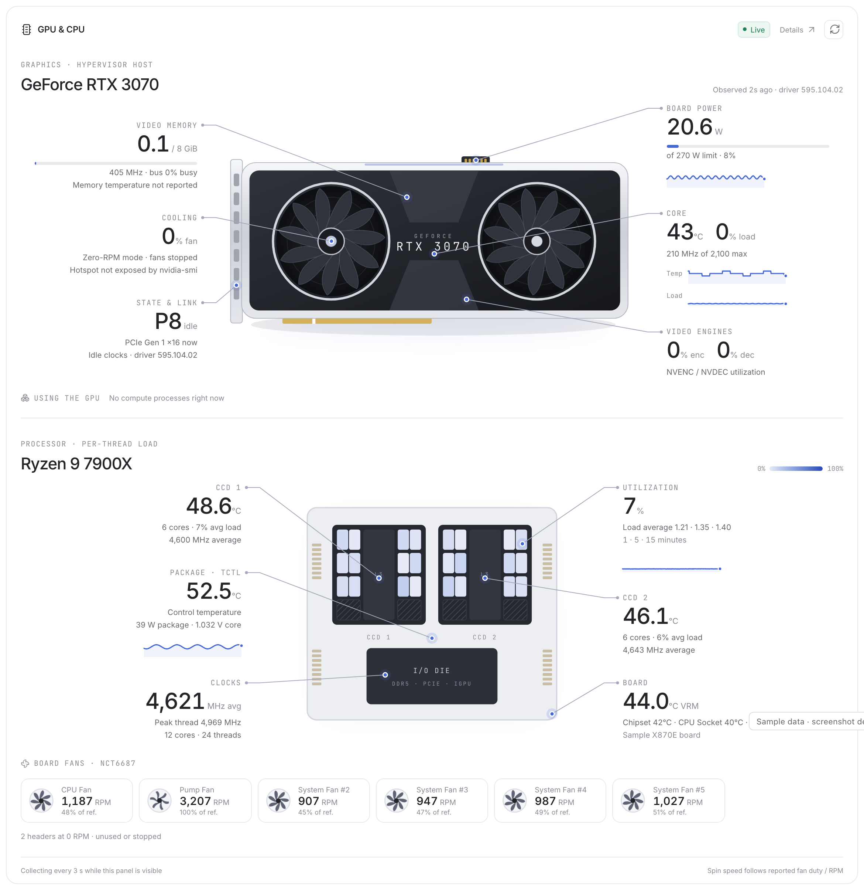
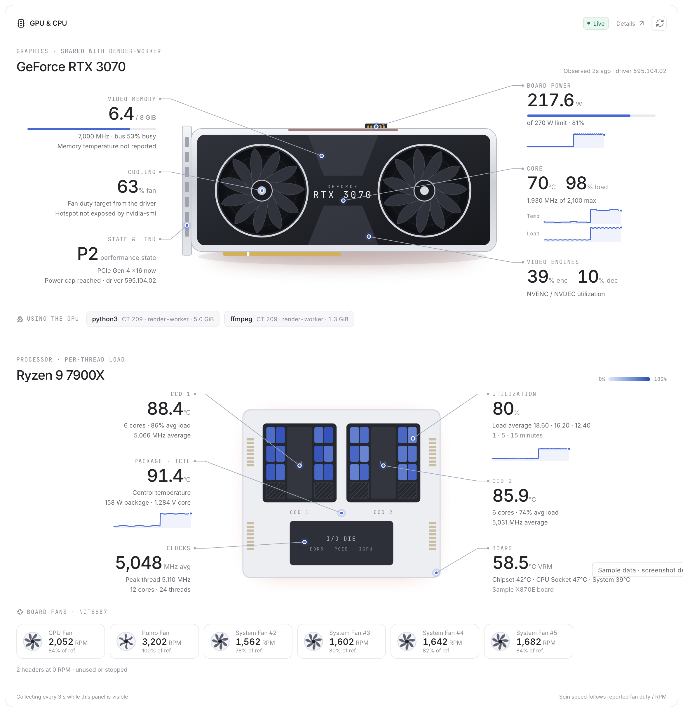
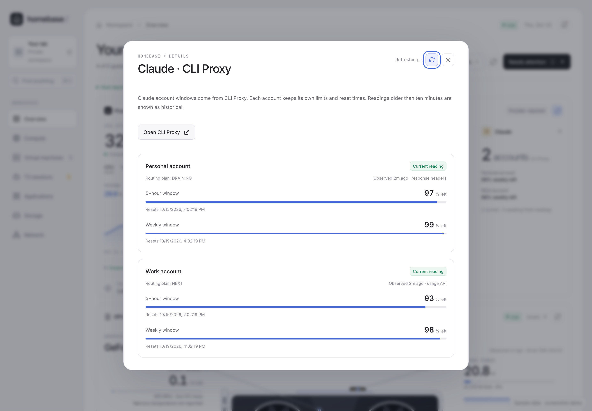

# Homebase

<p align="center"><a href="https://homebase.nevryk.com"><b>▶ Live demo: homebase.nevryk.com</b></a><br><sub>The real interface with sample data, served as a static site. No backend, no real readings.</sub></p>

<p align="center"></p>

<p align="center"><b>prox, live on the overview.</b> A 3D model of the Thermaltake The Tower 500 with the real parts inside, its fans, airflow you can see and the fan curves.<br><a href="docs/screenshots/case-demo.mp4">Watch the 76-second demo</a></p>

A private infrastructure dashboard with sampled metric history, thermal detail,
T3 session navigation, account usage, and an application launcher.

This is the standalone application repository. Infrastructure provisioning,
operator deployment tooling, and production configuration are maintained separately.
Node.js 24 is required for the backend's built-in SQLite support.

```sh
npm ci
npm run build
npm test
```

To explore the interface without infrastructure or credentials, build first and
run `npm run demo`, then open `http://127.0.0.1:4320`. This separate loopback-only
server uses synthetic data, disables outgoing application links, and never loads
production configuration. It is not the production backend.

For production, set `HOMEBASE_CONFIG` to your protected external configuration
file and run `npm start`. Preserve the authenticated HTTPS deployment; the demo
server must never replace it.

## 3D case view

The overview opens on a model of prox's case: the Thermaltake The Tower 500 (Snow, 388 × 398 × 608 mm) with:
- a Gigabyte RTX 3070 Gaming OC
- a Lian Li Galahad II Trinity 360
- an MSI MAG X870E Tomahawk
- Corsair Vengeance RGB DDR5
- a Thermaltake GF3 850W

The **Cooling** page shows only the case. Open it full screen at `/case/`.

- **Airflow:** smoke, motion-blurred streaks, or both. Air only crosses the case where it has mesh (the side strips, the top, the rear hex and the base), never through the glass. It flows around the board and parts, and the GPU gives off a few warm puffs. **Temp color** shades the air from cool to warm, and every exhaust leaves warm.
- **RGB:** on by default, in blue: the room goes dark and the fans, pump, RAM and GPU logo light in one color you pick. There is no rainbow mode. Off is a studio view with soft shadows.
- **Fans:** one list with each group's RPM and duty. Hover a row for details, or click it to show its curve. The rear fans switch between intake and exhaust, and the airflow balance shows intake against exhaust.
- **Views:** 3/4, Front, Radiator, Back, GPU and Top; Case, X-ray or Bare; a heat glow; optional labels. Everything is always dark, and the controls sit above the model, not on it.

Fan readings are **modeled** from 2026-10-15 values until fan telemetry is connected, and the panel says so. Nothing here changes the real fans. three.js r128 is bundled under `public/case/vendor`, so the page runs under `script-src 'self'`. Only `/case/` may be framed, and only by Homebase itself.

| Studio lighting | RGB on |
|---|---|
|  |  |
| **X-ray with airflow** | **Cooling page** |
|  |  |

## Live demo

[homebase.nevryk.com](https://homebase.nevryk.com) is this UI built in static mode (`VITE_STATIC_DEMO=1`). Instead of calling the backend, it reads JSON files exported from the loopback sample server, and timestamps shift so the readings always look fresh. Refreshes and acknowledgements are accepted and ignored. It runs on Cloudflare as static assets only, with no Worker code.

```sh
node scripts/export-static-demo.mjs                        # builds dist-demo/ from synthetic data only
npx wrangler@4 deploy -c deploy/live-demo.wrangler.jsonc   # homebase.nevryk.com
```

Never point the exporter at a production backend.

## Screenshots

These captures show the real interface with **sample data**. Names, accounts,
measurements, and application entries are illustrative; no production catalogue
or credentials were used.












## Force refresh

Every card and details modal has a refresh control. `POST /api/refresh/<source>`
(session + same-origin CSRF) accepts only known source IDs:

- `proxmox` re-reads the Proxmox API now.
- `proxy` calls CLI Proxy's fixed loopback `.../routing/quota/refresh` route,
  which polls each account's usage, then bypasses the 15-second cache.
- Collector scopes (`host`, `router`, `agents`, `quotas`, `compute`, `guest:<id>`)
  are handed to the authenticated bridge through a long-poll at
  `GET /api/ingest/requests`. The reply only names scopes the collector is
  already allowed to send; the bridge maps each one to its own fixed collector.
  The route waits up to 25 seconds for the new reading.

Each source can be refreshed once per 10 seconds (30 seconds for provider
quota sources). Passive sources (the Claude status line), unconnected sources,
and scopes whose bridge is not listening are shown disabled with the reason.

## GPU & CPU showcase

`collectors/read-compute.py` is piped to the hypervisor by the bridge as
`python3 -`. It runs only fixed `nvidia-smi --query-*` argv lists (no shell)
and reads numeric `/proc` and hwmon files; process names are reduced to the
executable basename. Board fan and temperature IDs match `read-linux.py`, so
`cooling.channels` roles and reference speeds apply. Per-thread load and
package power (RAPL) are differences between consecutive readings; the first
reading after a gap shows them as measuring. While the panel is visible the
browser polls `/api/compute?live=1`, which asks the bridge for 3-second
collection for 12 seconds at a time; otherwise the bridge collects every 30
seconds. Fan spin follows reported fan duty (GPU) or RPM (board), and glows
follow load and temperature. Reduced-motion users get a static illustration.

Fans never strobe: visual speed is capped below the wagon-wheel threshold and
crisp blades blend (opacity only) into trailing copies and a rotational blur
disc as speed rises; speed changes ease in. Reduced motion shows the blur that
matches the current speed without spinning.

Every part of the card and CPU package is a focusable hotspot. Hover or focus
spotlights it; tap, click, Enter, or Space opens a popover with the reading, the
last hour, and a "View history" action. Esc, an outside tap, or a second tap
closes it and returns focus.

## Part details

Clicking a side readout, a part of the illustration (wide layouts), the
popover's "Open details", a board fan, a process, or a row in the GPU & CPU
modal opens that part's detail: a modal on desktop and a bottom sheet at
640 px and below. Hover only previews. `GET /api/compute/groups/<group>?range=`
(session required; IDs from a fixed pattern in `server/compute-groups.mjs`)
returns the live header values, every metric in the group, facts, and figures
derived on the server from stored 30-second samples:

- energy used (each sample counts for its 30-second poll; gaps are not filled),
- time at or above 95 % of the power limit recorded at the same poll,
- time in each P-state and per clock-limiter reason
  (`clocks_throttle_reasons.active`, decoded in `server/gpu-reasons.mjs`).

CCD details include a per-thread grid; each thread has its own load history.
`#compute/<group>/<metric>` reopens the same detail.

## Per-metric history

`GET /api/metrics/<id>?range=1h|24h|7d` (session required) returns chart points
(min / avg / max) and statistics computed on the server over every stored
sample in range: current, average, min, max, nearest-rank P95 and P99, and the
times of the peak and low. IDs resolve through a fixed table in
`server/metrics.mjs` (GPU, CPU, and per-CCD metrics) plus board fan and
temperature sensor IDs that the hypervisor currently reports or that already
have stored samples. Request text is never placed in SQL.

Samples are written once per 30-second monitor poll, so live 3-second viewing
never over-weights a period. Two tiers keep storage bounded:

- `metric_raw`: every 30-second sample for 25 hours (1 h and 24 h views).
- `metric_buckets`: 5-minute buckets for 8 days with count, sum, min, max,
  the times of the min and max, and the bucket's samples (7 d view). Percentiles
  over 7 days therefore remain exact.

About 70 metrics are recorded on a 12-core, two-CCD host (per-thread load,
per-CCD figures, P-state, limiter bits). That measured 21.6 MB at steady state
(4.5 MB raw, 17.1 MB buckets), about 0.6 ms per poll to write. Old rows are pruned every ten minutes. The tables are
created automatically on start. On the first poll with GPU and board readings,
matching keys already in `history` are imported once.

## Data boundaries

Runtime configuration is supplied by `HOMEBASE_CONFIG` outside this repository.
Optional local icon files are supplied through `iconsDirectory`, catalogue
`iconFile` entries, and a `branding` map. Real logos and mappings stay in private
storage. Authenticated icon routes expose configured IDs only, reject active
image formats and path escapes, and never fetch remote images in the browser.
Application catalogues, service names, private addresses, account identities,
and credentials must stay in private runtime files. Do not add a real catalogue
or credential example here. Tests use synthetic application and account names.

The authenticated `/api/integrations` endpoint exposes only selected account
quota fields and the operator's configured application catalogue. Management
credentials remain server-side. Application links use IDs resolved from that
catalogue; arbitrary redirect destinations are rejected.

The CLI Proxy pacing report uses fractional 5-hour utilization and normalized
account-week capacity (`left / kappa`). Homebase converts these to percentages;
it never treats `0.99` remaining as `0.99%`. Quota freshness uses each account's
provider-observation time, not the generated report timestamp. After ten minutes
a reading is historical. Passed reset times and rolled-forward pacing projections
wait for a new observation; they never imply a freshly replenished quota.

Metric averages, lows, peaks, and nearest-rank P99 are calculated from original
finite samples. Chart downsampling does not change those summaries. Per-sensor
history begins when that sensor starts reporting; missing prior measurements
are never generated. Summary sample counts and observation coverage are shown.

Cooling details show read-only fan tachometer RPM with the same historical
summaries. Zero RPM can indicate an unused header or a stopped fan; it is not
treated as proof of failure. Missing readings remain unavailable.

Optional `cooling.channels` in the external runtime configuration assigns sensor
IDs a name, a `fan` or `pump` role, a `maxRpm` reference, and a `confirmed` flag.
Unassigned channels and pumps are excluded from the airflow estimate. Real
sensor mappings and hardware profiles belong outside this repository.

Estimated sound is a qualitative heuristic based on fan RPM divided by its
configured reference speed: below 35% is quiet, below 55% light airflow, below
80% audible airflow, and otherwise strong airflow. It is not measured dBA and
does not account for case acoustics, room noise, listener distance, or pump tone.
Inferred channel assignments remain visibly marked.

The non-X3D Ryzen 7000 X models use a 95°C thermal-limit reference. Near-limit
temperature under load is shown as boost context; high temperature at light
load or readings more than 2°C above the reference request a check. The 2°C
margin is a dashboard alert heuristic, not a revised hardware safety limit.
See [AMD's thermal explanation](https://community.amd.com/t5/gaming/ryzen-7000-series-processors-let-s-talk-about-power-temperature/ba-p/554629).
