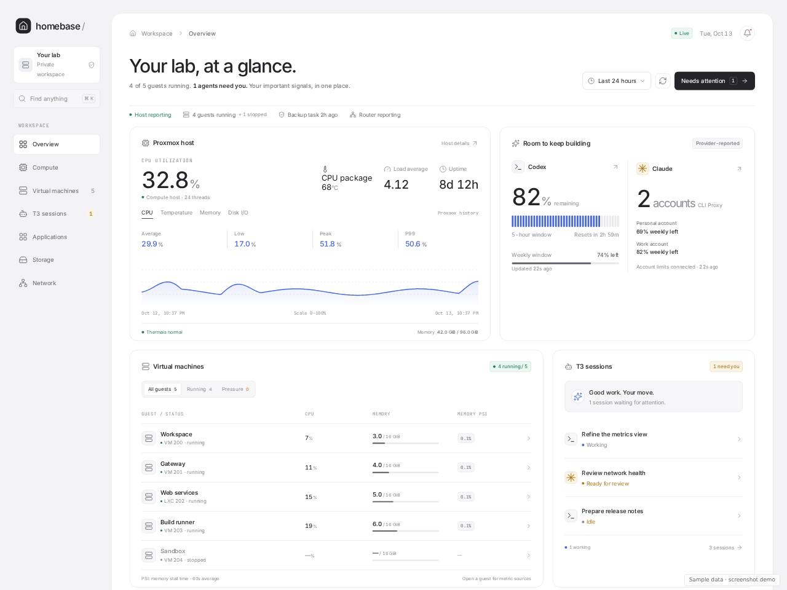
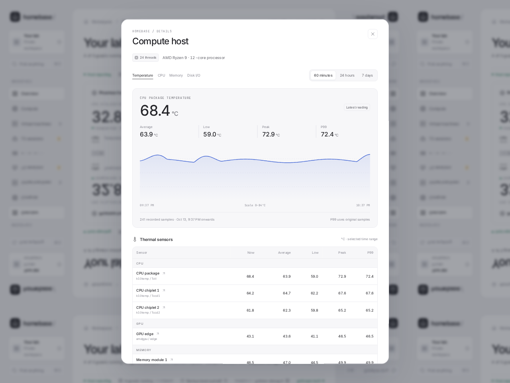
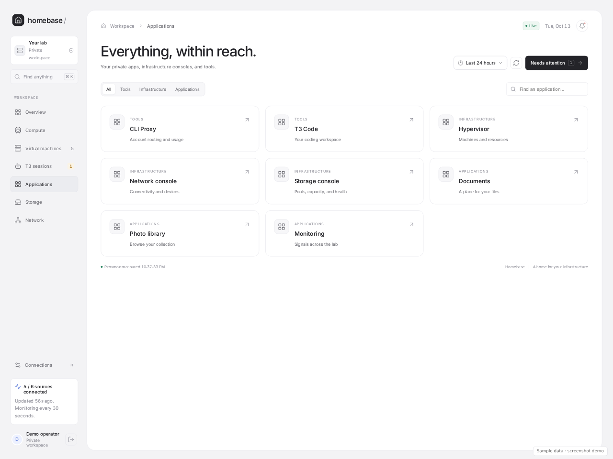

# Homebase

A private infrastructure dashboard with sampled metric history, thermal detail,
T3 session navigation, account usage, and an application launcher.

This is the standalone application repository. Infrastructure provisioning and
deployment tooling live in the private [operator repository](https://github.com/nsoliven/homebase/tree/29532d0ef6291facd9cb49a63d989c6763f3441c/scripts/homebase).
Node.js 24 is required for the backend's built-in SQLite support.

```sh
npm ci
npm run build
npm test
```

To explore the interface without infrastructure or credentials, build first and
run `npm run demo`, then open `http://127.0.0.1:4320`. This separate loopback-only
server uses synthetic data, disables outgoing application links, and never loads
production configuration. It is not the production backend.

For production, set `HOMEBASE_CONFIG` to your protected external configuration
file and run `npm start`. Preserve the authenticated HTTPS deployment; the demo
server must never replace it.

## Screenshots

These captures show the real interface with **sample data**. Names, accounts,
measurements, and application entries are illustrative; no production catalogue
or credentials were used.







## Data boundaries

Runtime configuration is supplied by `HOMEBASE_CONFIG` outside this repository.
Application catalogues, service names, private addresses, account identities,
and credentials must stay in private runtime files. Do not add a real catalogue
or credential example here. Tests use synthetic application and account names.

The authenticated `/api/integrations` endpoint exposes only selected account
quota fields and the operator's configured application catalogue. Management
credentials remain server-side. Application links use IDs resolved from that
catalogue; arbitrary redirect destinations are rejected.

Metric averages, lows, peaks, and nearest-rank P99 are calculated from original
finite samples. Chart downsampling does not change those summaries. Per-sensor
history begins when that sensor starts reporting; missing prior measurements
are never generated. Summary sample counts and observation coverage are shown.
